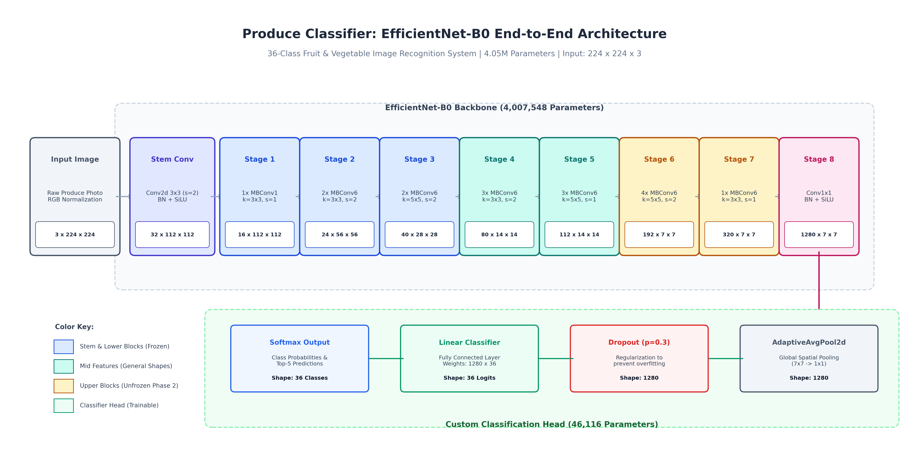

# Fruit and Vegetable Classifier

[](https://www.python.org/)
[](https://pytorch.org/)
[](https://streamlit.io/)
[](LICENSE)

An end-to-end deep learning image classification system that identifies **36 distinct fruit and vegetable categories** from a single photograph. Built with PyTorch, EfficientNet-B0 transfer learning, Grad-CAM visual explainability, and an interactive Streamlit web application.

---

## Overview

This project demonstrates a complete machine learning pipeline from raw dataset ingestion and exploratory analysis through two-phase transfer learning, rigorous evaluation, and a deployable web interface. The codebase is structured for reproducibility, clarity, and extensibility.

| Property | Detail |
|---|---|
| **Task** | 36-class image classification |
| **Architecture** | EfficientNet-B0 (transfer learning) |
| **Dataset** | Kaggle -- Fruit and Vegetable Image Recognition (~3,800 images) |
| **Test Accuracy** | **94.15%** |
| **Macro F1-Score** | **93.96%** |
| **Demo** | Streamlit web application |

---

## Results at a Glance

| Metric | Score |
|---|---|
| Test Accuracy | 94.15% |
| Macro Precision | 95.07% |
| Macro Recall | 94.10% |
| Macro F1-Score | 93.96% |
| Weighted F1-Score | 93.97% |

Evaluated on 359 held-out test images (10 per class). 26 of 36 categories achieved 100% precision or recall. Full per-class breakdown is documented in [`docs/results.md`](docs/results.md).

---

## Documentation

| Document | Description |
|---|---|
| [`docs/architecture.md`](docs/architecture.md) | Technical model architecture specification, visual component diagrams, and layer breakdown tables |
| [`docs/methodology.md`](docs/methodology.md) | Data pipeline, augmentations, two-phase transfer learning strategy, loss functions, and optimization |
| [`docs/results.md`](docs/results.md) | Full evaluation metrics, 36-class performance tables, error analysis, and confusion matrix interpretation |
| [`docs/deployment.md`](docs/deployment.md) | Local environment setup, single-image inference CLI, and Streamlit Community Cloud deployment |

---

## Visual Outputs

**Model Architecture (EfficientNet-B0 End-to-End)**



**Training and Validation Curves**


**Normalized Confusion Matrix (36 x 36)**


**GradCAM Visual Attention Heatmaps**


---

## Project Structure

```
Fruits & Vegetable Classifier/
|
+-- data/
|   +-- train/                    # 36 classes, 3,115 training images
|   +-- validation/               # 36 classes, 351 validation images
|   +-- test/                     # 36 classes, 359 test images
|
+-- docs/
|   +-- images/                   # High-resolution architectural and pipeline diagrams
|   +-- architecture.md           # Model architecture, layer specifications, and diagrams
|   +-- methodology.md            # Training strategy, augmentations, and design rationale
|   +-- results.md                # Detailed evaluation metrics and per-class analysis
|   +-- deployment.md             # Environment setup, inference CLI, and cloud deployment
|
+-- notebooks/
|   +-- 01_exploration.ipynb      # EDA: class distribution, sample gallery, image statistics
|
+-- src/
|   +-- __init__.py
|   +-- dataset.py                # PyTorch Dataset, augmentations, and DataLoader factory
|   +-- model.py                  # EfficientNet-B0 backbone with two-phase training control
|   +-- train.py                  # Training loop, AdamW, cosine LR schedule, early stopping
|   +-- evaluate.py               # Confusion matrix, classification report, GradCAM generation
|   +-- predict.py                # Single-image inference engine and CLI tool
|   +-- gradcam.py                # Native PyTorch Grad-CAM explainability pipeline
|
+-- results/
|   +-- best_model.pth            # Trained model checkpoint (weights + class mapping)
|   +-- classification_report.csv # Per-class precision, recall, and F1-score
|   +-- confusion_matrix.png      # 36x36 normalized confusion matrix
|   +-- gradcam.png               # GradCAM saliency heatmaps
|   +-- misclassifications.png    # Misclassified sample analysis
|   +-- training_curves.png       # Loss and accuracy over training epochs
|
+-- app.py                        # Streamlit web application with Grad-CAM visualization
+-- download_data.py              # Kaggle dataset download and directory setup
+-- train_config.yaml             # Centralized hyperparameter configuration
+-- requirements.txt              # Pinned Python dependencies
+-- .gitignore
+-- README.md
```

---

## Quick Start

See [`docs/deployment.md`](docs/deployment.md) for the full setup, training, and cloud deployment guide.

```bash
# 1. Clone and install
git clone https://github.com/<your-username>/fruits-vegetable-classifier.git
cd fruits-vegetable-classifier
pip install -r requirements.txt

# 2. Download dataset
python download_data.py

# 3. Train the model
python -m src.train

# 4. Run the web application
streamlit run app.py
```

---

## Dataset

**Kritik Seth** -- [Fruit and Vegetable Image Recognition](https://www.kaggle.com/datasets/kritikseth/fruit-and-vegetable-image-recognition) (36 classes, ~3,800 images), available on Kaggle.

---

## License

This project is open-source and available under the [MIT License](LICENSE).
