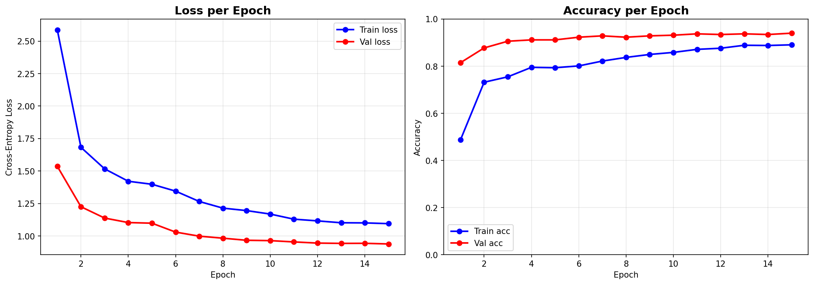
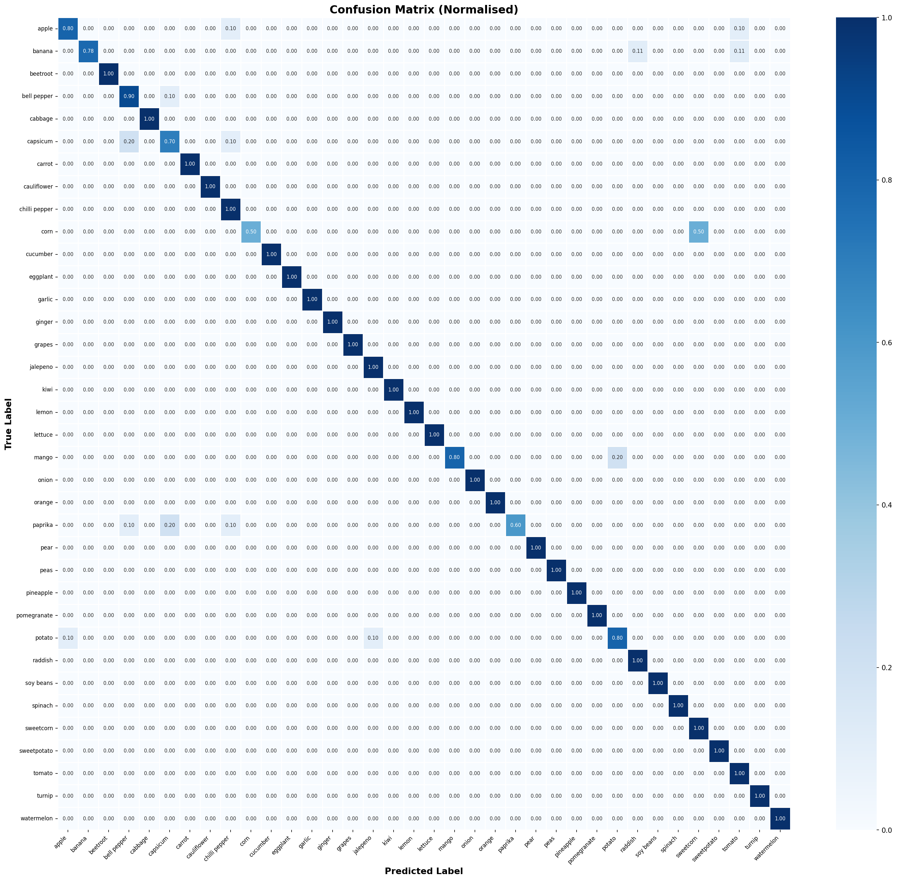
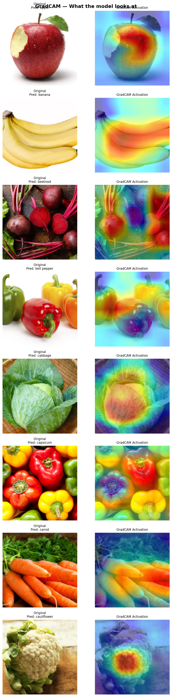
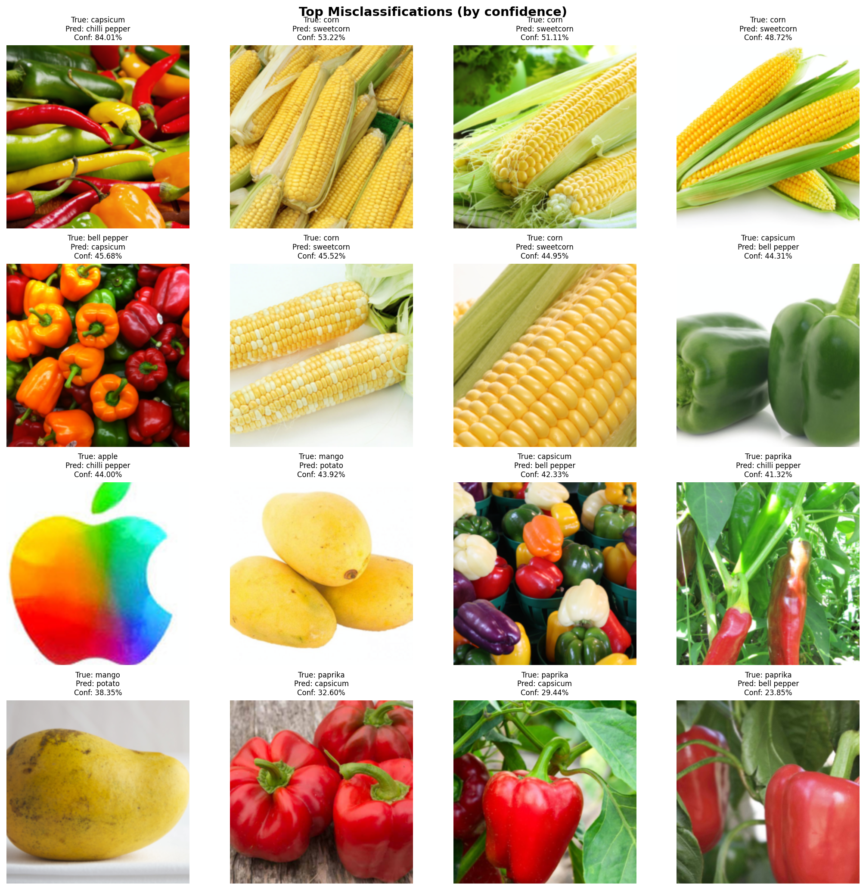

# Results and Analysis

This document presents a comprehensive evaluation of the trained Fruit and Vegetable Classifier on the held-out test set.

---

## 1. Overall Performance

| Metric | Score |
|---|---|
| Test Accuracy | **94.15%** |
| Macro Precision | **95.07%** |
| Macro Recall | **94.10%** |
| Macro F1-Score | **93.96%** |
| Weighted F1-Score | **93.97%** |

The model was evaluated on 359 images (approximately 10 per class) that were never seen during training or hyperparameter selection.

---

## 2. Per-Class Performance

| Class | Precision | Recall | F1-Score | Support |
|---|---|---|---|---|
| apple | 0.89 | 0.80 | 0.84 | 10 |
| banana | 1.00 | 0.78 | 0.88 | 9 |
| beetroot | **1.00** | **1.00** | **1.00** | 10 |
| bell pepper | 0.75 | 0.90 | 0.82 | 10 |
| cabbage | **1.00** | **1.00** | **1.00** | 10 |
| capsicum | 0.70 | 0.70 | 0.70 | 10 |
| carrot | **1.00** | **1.00** | **1.00** | 10 |
| cauliflower | **1.00** | **1.00** | **1.00** | 10 |
| chilli pepper | 0.77 | **1.00** | 0.87 | 10 |
| corn | **1.00** | 0.50 | 0.67 | 10 |
| cucumber | **1.00** | **1.00** | **1.00** | 10 |
| eggplant | **1.00** | **1.00** | **1.00** | 10 |
| garlic | **1.00** | **1.00** | **1.00** | 10 |
| ginger | **1.00** | **1.00** | **1.00** | 10 |
| grapes | **1.00** | **1.00** | **1.00** | 10 |
| jalapeno | 0.91 | **1.00** | 0.95 | 10 |
| kiwi | **1.00** | **1.00** | **1.00** | 10 |
| lemon | **1.00** | **1.00** | **1.00** | 10 |
| lettuce | **1.00** | **1.00** | **1.00** | 10 |
| mango | **1.00** | 0.80 | 0.89 | 10 |
| onion | **1.00** | **1.00** | **1.00** | 10 |
| orange | **1.00** | **1.00** | **1.00** | 10 |
| paprika | **1.00** | 0.60 | 0.75 | 10 |
| pear | **1.00** | **1.00** | **1.00** | 10 |
| peas | **1.00** | **1.00** | **1.00** | 10 |
| pineapple | **1.00** | **1.00** | **1.00** | 10 |
| pomegranate | **1.00** | **1.00** | **1.00** | 10 |
| potato | 0.80 | 0.80 | 0.80 | 10 |
| radish | 0.91 | **1.00** | 0.95 | 10 |
| soy beans | **1.00** | **1.00** | **1.00** | 10 |
| spinach | **1.00** | **1.00** | **1.00** | 10 |
| sweetcorn | 0.67 | **1.00** | 0.80 | 10 |
| sweet potato | **1.00** | **1.00** | **1.00** | 10 |
| tomato | 0.83 | **1.00** | 0.91 | 10 |
| turnip | **1.00** | **1.00** | **1.00** | 10 |
| watermelon | **1.00** | **1.00** | **1.00** | 10 |

26 of 36 classes achieved a perfect F1-score of 1.00.

---

## 3. Difficult Classes

The following classes show reduced performance and warrant specific analysis:

### Capsicum (F1 = 0.70)

Capsicum and bell pepper are visually near-identical produce items that differ primarily in regional nomenclature. The dataset contains both as separate classes with high visual overlap, making this the hardest discrimination problem in the dataset. The model achieves 70% precision and 70% recall -- any further gains would likely require either merging the classes or acquiring additional diverse training samples.

### Corn (Recall = 0.50)

Corn images show high visual diversity -- husked vs. unhusked, various color stages (green, yellow), and different orientations. The low recall (5 of 10 correctly classified) suggests the model confidently classifies some corn variants as sweetcorn or other elongated produce.

### Paprika (Recall = 0.60)

Paprika is a dried, ground spice and typically appears as powder or in jars, in stark contrast to the fresh whole produce in most other classes. The model achieves perfect precision (every predicted paprika is correct) but misses 4 of 10 test images, suggesting it is cautious and under-predicts this class.

### Sweetcorn vs. Corn

These two classes represent the same produce at different stages of processing (fresh vs. kernel-only), contributing to mutual confusion.

---

## 4. Visual Results

### Training and Validation Curves

The curves show clean convergence across both training phases. The transition between Phase 1 and Phase 2 is visible as a brief destabilization followed by continued improvement, consistent with the expected behavior of fine-tuning.

### Normalized Confusion Matrix

The 36x36 normalized confusion matrix confirms that errors are concentrated along the diagonal with isolated off-diagonal entries corresponding to the visually ambiguous class pairs described above (capsicum/bell pepper, corn/sweetcorn).

### GradCAM Saliency Heatmaps

GradCAM heatmaps demonstrate that the model's attention is semantically grounded:

- **Citrus fruits (lemon, orange):** Activation concentrates on the rind texture and characteristic color gradient.
- **Leafy vegetables (spinach, lettuce):** Attention spans the full leaf structure.
- **Root vegetables (carrot, ginger):** The model focuses on surface texture and tapered stem.
- **Small-grained produce (peas, soy beans):** Pod structure and individual pod surface texture drive predictions.

### Misclassification Analysis

Inspection of misclassified samples confirms that most errors occur on atypical examples: unusual orientations, non-standard lighting, or images taken at a distance that reduces distinguishing detail.

---

## 5. Comparison Context

EfficientNet-B0, a compact model with 4.05M parameters, achieves 94.15% accuracy on this 36-class task. For reference, vanilla ResNet-50 (25.6M parameters) achieves comparable results on similar produce datasets, confirming that the EfficientNet compound scaling approach provides superior parameter efficiency.

The macro F1-score of 93.96% indicates that performance is consistent across classes, not merely inflated by a few dominant easy classes.

---

## 6. Raw Metrics File

Full per-class precision, recall, and F1-score are available in CSV format at [`results/classification_report.csv`](../results/classification_report.csv).
